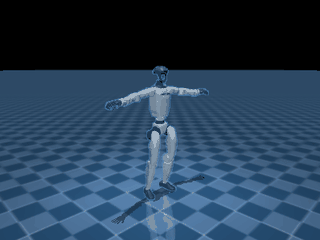

# SuperMimic-mjlab

A reference implementation of **SuperMimic: Scaling Humanoid Whole-Body Control with One
Differentiable World Model** (CoRL 2026) on top of [mjlab](https://github.com/mujocolab/mjlab)
and its MuJoCo Warp simulator.

> Paper: [arXiv:2610.28480](https://arxiv.org/abs/2610.28480) · Project page: <https://supermimic.github.io>

The package trains **one** goal-conditioned whole-body controller over a multi-skill motion
library. Instead of running model-free RL on every motion, it fits a single differentiable
world model of the shared humanoid dynamics from logged simulator transitions, then improves
the policy by back-propagating an imagined return through that frozen model (short-horizon
BPTT with a critic that bootstraps beyond the horizon). The loop follows Algorithm A.1 of the
paper; the default G1 configuration reproduces Table A.5.

```text
(1) collect  π_θ ──a+ε──> MuJoCo Warp ──(s, a+ε, ξ)──> replay buffer B
(2) fit      B ──k-step autoregressive windows──> f_ω, r_ω, g_ω, d_ω      (L_WM)
(3) improve  frozen f_ω ──H imaginal steps──> θ ← θ + α ∇_θ Ĵ            (BPTT + GAE critic)
```

## What is implemented

| Component | Module |
|---|---|
| Training loop: collect → fit → imagine | [`algo/trainer.py`](src/supermimic/algo/trainer.py) |
| World model, goal encoder, shared decoder, critic | [`algo/networks.py`](src/supermimic/algo/networks.py) |
| Batched differentiable forward kinematics for hinge/slide trees | [`algo/kinematics.py`](src/supermimic/algo/kinematics.py) |
| Per-environment ring buffer with episode-aware window sampling | [`algo/buffer.py`](src/supermimic/algo/buffer.py) |
| Return-based reset sampling over 1-second bins | [`algo/sampler.py`](src/supermimic/algo/sampler.py) |
| Tracking reward, survival weight, termination | [`algo/reward.py`](src/supermimic/algo/reward.py) |
| State layout (proprio goal and world-model state) | [`algo/state.py`](src/supermimic/algo/state.py) |
| MDP terms: motion library, commands, features, terminations | [`mdp/`](src/supermimic/mdp) |
| Unitree G1 environment and RL configs | [`config/g1/`](src/supermimic/config/g1) |
| `train` / `play` / `evaluate` / `preprocess` scripts | [`scripts/`](src/supermimic/scripts) |

Everything else (envs, managers, assets, viewer) comes from `mjlab`.

## Install

Requires Python ≥ 3.10 and a CUDA GPU for the MuJoCo Warp simulator (CPU smoke tests work
too, but training does not).

```bash
git clone https://github.com/YHFone/supermimic-mjlab
cd supermimic-mjlab
pip install -e ".[dev]"        # or: uv pip install -e ".[dev]"
```

The `mjlab` dependency is pulled from PyPI; the code targets mjlab ≥ 1.6.

## Quick start

Preprocess a motion set into the on-disk format (BONES-SEED or LAFAN1 retargets):

```bash
supermimic-preprocess \
    --dataset-root ~/motion_data/bones-seed \
    --output-dir   ~/motion_data/supermimic/g1_1200 \
    --max-clips 1200 --min-duration-s 2.0 --max-duration-s 30.0
```

Train (4,096 parallel environments on one GPU by default):

```bash
supermimic-train --motion-dir ~/motion_data/supermimic/g1_1200 --num-envs 4096
```

Watch the policy (Viser at <http://localhost:8091>; the reference robot is overlaid and can be
toggled under "SuperMimic reference"):

```bash
supermimic-play --checkpoint logs/supermimic/g1_supermimic/<timestamp>/checkpoint_final.pt \
                --motion-dir ~/motion_data/supermimic/g1_1200 --viewer viser
```

Evaluate deterministically, one rollout per motion:

```bash
supermimic-evaluate --checkpoint logs/supermimic/g1_supermimic/<timestamp>/checkpoint_final.pt \
                    --motion-dir ~/motion_data/supermimic/g1_1200 \
                    --num-envs 64 --episodes-per-env 4
```

Every algorithm hyperparameter is a `--sm.<field>` override; the full list is in
[`algo/config.py`](src/supermimic/algo/config.py). The G1 defaults are in
[`config/g1/rl_cfg.py`](src/supermimic/config/g1/rl_cfg.py).

## Deployment (ONNX → `g1_deploy`)

The policy ships to the Unitree G1 deployment package
(`unitree_g1_ws/src/g1_deploy`) as a single-input ONNX graph that turns
`[obs | goal]` into the actor's action; the observation/goal normalization and the
goal encoder's `tanh` are baked into the graph, so the C++ side only assembles
raw numbers.

```bash
# 1) policy: obs 930 (10 x 93) + goal 730 (10 x 73) -> action 29
supermimic-export-onnx \
    --checkpoint logs/<run>/checkpoint_0036000.pt \
    --output        ../g1_deploy/tf_s1_infer/policy/g1_supermimic_36k.onnx

# 2) reference clip -> deploy playback format (71 floats/frame)
supermimic-export-motion \
    --motion ~/motion_data/supermimic/g1_lafan1_40/walk1_subject1.npz \
    --out    ../g1_deploy/tf_s1_infer/motions/walk1_subject1.bin
```

`supermimic-export-onnx` writes a `.json` sidecar (shapes, term order, joint
names, `default_joint_pos`, `action_scale`, `kp/kd`, joint limits) and verifies the
graph against the PyTorch actor with onnxruntime (fails above `1e-4`; the 36k
checkpoint of the default G1 run lands at `6.7e-06`).

The goal layout is the *deployment contract*: clip frame `t` supplies the anchor
origin, goal frame `k` is reference frame `t+1+k`, anchor positions are relative
to the reference (`R(q_ref(t))ᵀ (p_ref(t+1+k) − p_ref(t))`), anchor orientations
are relative to the robot root (first two matrix columns), and each goal frame
carries the reference linear/angular velocity in its own frame. Because positions
are reference-relative, deployment needs no base-position estimate — IMU and joint
encoders are enough. `algo/deploy_features.py` is the NumPy reference
implementation of that contract; `tests/test_deploy_features.py` pins it against
`GoalFeatures`/`ProprioFeatures`, and the deploy package's
`supermimic_adapter_check` binary dumps the C++ input for an end-to-end diff
(measured agreement `1.8e-07`).

## Results

Checkpoint at 22k iterations (LAFAN1 40-clip subset), evaluated deterministically on all 40
clips: one 60 s rollout per clip, no domain randomization, no observation noise, single
RTX 4090.

| Metric | Value |
|---|---|
| Clips evaluated | 40 (one rollout each, 60 s) |
| Success rate | **40/40** (no fall / anchor terminations) |
| Mean normalized return | **0.895** |
| Mean anchor position error | **8.1 cm** |
| Mean anchor rotation error | **0.053 rad** (≈ 3.0°) |
| Rollout speed | 75 steps/s with 40 environments |

Normalized return is the undiscounted episode return divided by the largest attainable value,
as in the paper (per-step ceiling 0.1). Per-clip records are in
[`docs/results/lafan1_40_eval_0022000.json`](docs/results/lafan1_40_eval_0022000.json); the
hardest clips by anchor error are `sprint1_subject4` (0.201 m), `run2_subject1` (0.197 m) and
`fallAndGetUp1_subject5` (0.172 m).



*`dance1_subject1`, 5 s excerpt (22k checkpoint). White: the policy. Blue: a translucent ghost of
the reference motion, rendered from the motion library and composited with a segmentation mask
so both skeletons share one camera.*

A full **60 s 1080p** clip with the 24k checkpoint is here:
[`docs/assets/lafan1_dance_60s_24k_1080p.mp4`](docs/assets/lafan1_dance_60s_24k_1080p.mp4)
(1920×1080, 25 fps, H.264). GitHub does not embed video in Markdown, so it is linked rather than
shown; the same ghost compositing is used.

## Documentation

- [`docs/training.rst`](docs/training.rst) — full training guide (data pipeline, spaces,
  reward, the three-phase loop, hyperparameters, evaluation protocol).
- [`docs/paper_reading_zh.md`](docs/paper_reading_zh.md) — 中文精读：逐节翻译、全部公式与符号拆解
  （式 (1)–(3)、(A.1)、奖励表、符号字典、复现清单与批判性点评）.
- [`docs/ppo_vs_bptt.md`](docs/ppo_vs_bptt.md) — 中文长文：PPO 与 BPTT 两种策略梯度估计的
  偏差/方差、成本、实测数字与选型建议.
- [`docs/gradient_flow_zh.md`](docs/gradient_flow_zh.md) — 中文：梯度在这份实现里到底怎么流
  （三次反向传播、BPTT 的反向递推、被切断的边界、`scratch/grad_probe.py` 的可复现消融实测）.

## Tests

```bash
pytest -q                      # fast unit tests (buffer, config, kinematics, networks)
pytest -q tests/test_smoke.py  # end-to-end smoke test (needs GPU + MuJoCo Warp)
```

The kinematics test asserts that batched forward kinematics matches MuJoCo to `1e-6`; the
buffer test asserts replay windows never cross episode boundaries; `test_paper_params.py`
pins the defaults to Table A.5 of the paper.

## Citation

```bibtex
@inproceedings{liao2026supermimic,
  title     = {SuperMimic: Scaling Humanoid Whole-Body Control with One Differentiable World Model},
  author    = {Liao, Qiayuan and Shao, Yiyang and Long, Junfeng and Zakka, Kevin and
               Horowitz, Roberto and Abbeel, Pieter and Sreenath, Koushil},
  booktitle = {Conference on Robot Learning (CoRL)},
  year      = {2026},
  eprint    = {2610.28480},
  archivePrefix = {arXiv}
}
```

If you use the simulator stack, please also cite mjlab / MuJoCo Warp.

## License

Apache-2.0. This package derives from [mjlab](https://github.com/mujocolab/mjlab)
(Copyright 2025, The mjlab Developers, Apache-2.0); see [`LICENSE`](LICENSE).

## Acknowledgements

The method is from the SuperMimic authors (UC Berkeley). The simulator, environment API,
robot assets and viewer are from mjlab. Motion data by Bones Studio (BONES-SEED) and LAFAN1.
