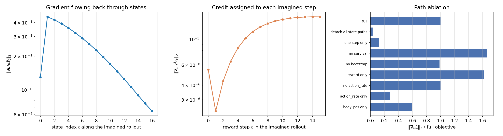

# SuperMimic 的梯度是怎么传播的

> **配套**：方法论层面的对比（PPO vs BPTT）见 [ppo_vs_bptt.md](ppo_vs_bptt.md)；本文只回答一个问题——**在这份实现里，梯度从损失出发，经过哪些算子、在哪里被切断、最后落到谁身上**。
>
> **代码**：[trainer.py](../src/supermimic/algo/trainer.py)（三次反向传播）、[networks.py](../src/supermimic/algo/networks.py)（世界模型 / actor / critic）、[reward.py](../src/supermimic/algo/reward.py)（可微奖励）、[kinematics.py](../src/supermimic/algo/kinematics.py)（可微 FK）。
>
> **实测**：[`scratch/grad_probe.py`](../scratch/grad_probe.py) 用一条 3 刚体 2 关节的玩具机器人复刻同一段想象循环，CPU 上几秒跑完，数字见 §6。

---

## 0. 一句话版本

一次 iteration 里跑**三次彼此独立的反向传播**，参数集合互不重叠：

| 阶段 | 损失 | 梯度落在 | 计算图里都经过什么 | 代码 |
| --- | --- | --- | --- | --- |
| 世界模型拟合 | $\mathcal L_\text{wm}$（多步预测 MSE + 终止 BCE） | `world_model.net` / `term_net` | 只有 $f_\omega$ 自己，8 步自回归 | `trainer.py:346` |
| 策略改进 | $-\hat J$（想象回报） | `actor_critic.encoder/decoder` | **冻结的** $f_\omega$、可微 FK、可微奖励、终止头、**冻结的** critic | `trainer.py:483` |
| Critic 拟合 | TD(λ) 回归 | `actor_critic.critic` | 只有 $V_\phi$；目标在 `no_grad` 下算好 | `trainer.py:636` |

策略那一路是全部复杂度所在：**它不是 REINFORCE，而是 pathwise derivative**。回报是参数 $\theta$ 的确定性函数，梯度沿 32 步想象轨迹按链式法则一路传回，中途穿过一个"参数冻结但依然可微"的世界模型。这就是 SHAC 那一类做法，也是本文 §2 的主题。

---

## 1. 全景：三条梯度线

```
                        ┌──────────────── 回放缓冲区（全部 detach）────────────────┐
                        │  s0, a_{-1}, 过去 9 帧观测, ξ, 参考动作窗口 ref(t)      │
                        └───────────────┬────────────────────────────────────────┘
                                        │
   for t = 0 … H-1                      ▼
   ┌──────────────────────────────────────────────────────────────────────────┐
   │  d̂_t = σ(h_ω(s_t, g_t)) ──────────────────────────┐(乘进存活权重)        │
   │                                                    │                     │
   │  s_t ──φ──▶ o_t ──π_θ──▶ a_t ──┬──▶ ρ(·)  ← action_rate 直连            │
   │   │                             │                                        │
   │   │                             └──▶ f_ω(s_t, a_t, ξ) ──▶ s_{t+1}       │
   │   │                                                        │  │          │
   │   └────────── A_t = ∂f_ω/∂s_t ◀───────────────────────────┘  │          │
   │                                                              ▼          │
   │                                            FK ──▶ ρ(·)  ← 跟踪奖励项    │
   └──────────────────────────────────────────────────────────────────────────┘
                                        │
                          bootstrap: V_φ(s_H, g_H, ξ)   （参数冻结，输入可微）
                                        ▼
                        objective ──▶ backward ──▶ clip ──▶ Adam(actor)
```

三条线的**唯一耦合点是数据**：世界模型用真实转移拟合，actor 用世界模型的想象轨迹改进，critic 在想象轨迹上做 TD(λ)。三者的参数梯度从不混在一起——想区分"策略退化了"还是"模型变差了"，这是关键的设计事实。

---

## 2. 策略更新：梯度如何穿过世界模型

### 2.1 目标函数

`trainer.py:560-566` 逐行对应下面这个式子（$S_t$ 是到第 $t$ 步为止仍存活的概率）：

$$
\hat J(\theta)=\sum_{t=0}^{H-1}\gamma^{t}\,S_t\,\hat r_t \;+\; \gamma^{H}S_H\,V_\phi(\hat s_H,g_H,\xi),
\qquad
S_t=\prod_{k=0}^{t-1}\bigl(1-\hat d_k\bigr),\quad S_0=1
$$

其中 $\hat r_t$ 由 $(\hat s_{t+1},a_t,a_{t-1})$ 算出（真实代码里 `chunk_rewards[t]` 就是这个量），$\hat d_k\in(0,1)$ 是学出来的软终止概率。损失是 $-\hat J$ 在 batch 上的均值，再乘 chunk 权重做梯度累加（`trainer.py:567`）。

三个"额外"的结构值得注意，它们都不是标准 PPO 有的：

1. **软终止**：$\hat d_k$ 是状态的可微函数，所以 $\partial\hat J/\partial\theta$ 里天然带一项"别让轨迹终止"的梯度，而不是靠硬约束或惩罚项；
2. **horizon 末端自举**：$\gamma^H S_H V_\phi(\hat s_H,g_H,\xi)$，梯度会穿过**冻结的** critic 回到 actor；
3. **目标函数的每一项都可微**：奖励、FK、终止头、critic 全部是 $\theta$ 的复合函数。

### 2.2 单步的计算图

$$
\begin{aligned}
o_t &= \phi\bigl(\hat s_t,\,a_{t-1},\,b\bigr) &&\text{proprio obs}\\
a_t &= \pi_\theta\bigl(o_{t-9:t},\,g_t\bigr) &&\text{10-frame history + goal}\\
\hat s_{t+1} &= f_\omega(\hat s_t,\,a_t,\,\xi) &&\text{residual dynamics}\\
\hat r_t &= \rho\bigl(\mathrm{FK}(\hat s_{t+1}),\,a_t,\,a_{t-1};\,\bar s_t\bigr) &&\text{tracking reward}\\
\hat d_t &= \sigma\bigl(h_\omega(\hat s_t,\,g_t)\bigr) &&\text{soft termination}\\
g_{t+1} &= \psi\bigl(\bar s_{t+1:t+K+1},\,\mathrm{quat}(\hat s_{t+1})\bigr) &&\text{goal re-anchored on the root pose}
\end{aligned}
$$

`features.py:60`（观测）/ `networks.py:157`（动力学）/ `kinematics.py:219`（FK）/ `reward.py:118`（奖励）/ `networks.py:199`（终止头）/ `features.py:139`（目标）分别对应上面六行。

### 2.3 反向递推（核心）

记 $\delta_t=\partial\hat J/\partial\hat s_t$ 是状态的反向伴随，$\alpha_t=\partial\hat J/\partial a_t$ 是动作的偏导，$A_t=\partial f_\omega/\partial\hat s_t$。反向传播就是下面这个递推：

$$
\delta_t
=\underbrace{A_t^{\top}\,\delta_{t+1}}_{\text{(1) dynamics}}
+\underbrace{\Bigl(\frac{\partial a_t}{\partial\hat s_t}\Bigr)^{\!\top}\alpha_t}_{\text{(2) re-observation}}
+\underbrace{\Bigl(\frac{\partial\hat d_t}{\partial\hat s_t}\Bigr)^{\!\top}\frac{\partial\hat J}{\partial\hat d_t}}_{\text{(3) survival}}
+\underbrace{\Bigl(\frac{\partial g_{t+1}}{\partial\hat s_t}\Bigr)^{\!\top}\frac{\partial\hat J}{\partial g_{t+1}}}_{\text{(4) goal}}
$$

而参数梯度是每一步"动作通量"的累加：

$$
\frac{d\hat J}{d\theta}
=\sum_{t=0}^{H-1}
\underbrace{\Bigl[\alpha_t+\Bigl(\frac{\partial\hat s_{t+1}}{\partial a_t}\Bigr)^{\!\top}\delta_{t+1}\Bigr]^{\top}}_{\bar\alpha_t^{\top}}
\frac{\partial a_t}{\partial\theta}
$$

四项的物理含义：

| 项 | 数学形态 | 直觉 | 何时为零 |
| --- | --- | --- | --- |
| (1) 动力学 | $A_t^{\top}\delta_{t+1}$ | "这一步的状态偏移，会让后面 31 步的回报怎么变" | 世界模型输出上 `detach()` 时 |
| (2) actor 重新观测 | $(\partial a_t/\partial\hat s_t)^{\top}\alpha_t$ | 下一步的策略输入是下一步的状态，状态误差会变成动作误差 | 状态从图上断开时 |
| (3) 存活 | $(\partial\hat d_t/\partial\hat s_t)^{\top}\partial\hat J/\partial\hat d_t$ | 状态影响终止概率，终止概率打折未来回报 | $\hat d$ 用阈值/指示函数时（不可微） |
| (4) 目标重编码 | $(\partial g_{t+1}/\partial\hat s_t)^{\top}\partial\hat J/\partial g_{t+1}$ | 目标锚在根姿态上，状态一变目标也变 | 目标不从状态算时 |

**(1) 是唯一让信用跨越一步以上的项**，它就是把 BPTT 和"单步 TD 反传"区分开的东西：$A_t$ 连乘 $H$ 次，等价于穿过一个 $H$ 层的残差 RNN。

### 2.4 各算子的雅可比长什么样

| 算子 | 代码 | 可微成分 | 备注 |
| --- | --- | --- | --- |
| 世界模型 $f_\omega$ | `networks.py:157` | 对 $\hat s_t$ 和 $a_t$ 都可微 | 输出是残差 + 四元数增量旋转，最后重新归一化到单位球 |
| 可微 FK | `kinematics.py:219` | 对 root pose / joint pos / joint vel 可微 | 纯 `torch` 实现，逐 level 批量前向；可选 `torch.compile`（`trainer.py:685` 会先把 forward+backward 编译预热） |
| 奖励 $\rho$ | `reward.py:118` | 8 项全部可微 | $\exp(-\lVert e\rVert^2/\sigma^2)$ 形态，处处平滑；四元数误差用 $\arccos$ 且 `clamp` 到 $1-10^{-6}$ 防梯度爆炸 |
| 终止头 $\hat d$ | `networks.py:199` | sigmoid，可微 | 初始 bias 设成 5% 先验，避免一开始 $S_t$ 就把有效视野压到 2 步 |
| actor $\pi_\theta$ | `networks.py:283` | `obs_norm`/`goal_norm` 是**仿射**，统计量本身是 buffer | 归一化算子可微，但梯度不会更新统计量 |
| critic $V_\phi$ | `networks.py:290` | 参数冻结，输入可微 | bootstrap 的梯度照样回传到 actor |

### 2.5 梯度在哪里被切断

这是最容易被忽略的部分，逐条列出来：

| 切断点 | 机制 | 后果 |
| --- | --- | --- |
| 世界模型参数 | `_set_requires_grad(wm, False)`（`trainer.py:489`） | 参数张量 `.grad` 恒为 `None`（探针里 12 个，G1 配置 14 个）；但**计算图仍然建立**，梯度仍穿过函数本身 |
| critic 参数 | `trainer.py:490` | 只有 bootstrap 用到它，参数不更新但输入可微 |
| 起点与历史帧 | 来自 `buffer`，天然 detach | 窗口里只有"最新两帧"带图（本步的 `o_t` 与上一步的 `o_{t-1}`） |
| chunk 边界 | `policy_chunk_size` 把 batch 切成多块，逐块 `backward()` 累加 | 每个 chunk 是**不同**的起始状态，本来就该互相独立；这纯粹是显存手段 |
| 归一化统计量 | `RunningNorm` 用 `register_buffer` | 均值/方差无梯度，但它们在 `_collect` 里持续更新，等价于"梯度是对一个缓慢变化的函数求的" |
| 观测噪声 | `proprio(...)` 默认 `add_noise=True`（`trainer.py:526`） | 均匀噪声是 `torch.rand` 采样，**没有重参数化**，只给梯度估计加方差，不贡献梯度 |
| 参考动作 | `library.gather(...)` 返回 buffer | $\bar s_t$ 是常数，$\partial\bar s/\partial\theta=0$ |

### 2.6 梯度落地：裁剪与步长

```python
if bad_grads == 0:
    torch.nn.utils.clip_grad_norm_(self.actor_params, cfg.grad_clip)   # 1.0
    for p in self.actor_params:
        p.grad.clamp_(-cfg.grad_clip_elementwise, cfg.grad_clip_elementwise)  # 0.1
    self.actor_optimizer.step()
else:
    self.actor_optimizer.zero_grad(set_to_none=True)
```

（`trainer.py:589-596`）

两次裁剪是**串联**的，而且逐元素那个比全局范数那个激进得多：全局范数裁到 1 之后，单个分量的绝对值仍可达 1，再被 `clamp` 到 0.1。对形状"少数几个坐标特别大"的梯度，这一步会把更新方向掰向近似 `sign(g)`；Adam 又自带尺度归一，所以最终效果是"只保留方向、而且被量化过"。$H=32$ 的 BPTT 里梯度范数天然不稳定，这段是 SHAC 系方法的标配保险，不是可选项。

`bad_grads` 的语义也值得注意：出现任何非有限梯度，**这一整次 actor 更新直接丢弃**（并清零），而不是裁剪后继续。

---

## 3. 世界模型的梯度

`trainer.py:346-392`：

$$
\mathcal L_\text{wm}
=\frac1k\sum_{j=0}^{k-1}\ell\bigl(f_\omega(\hat s_j,a_j,\xi),\,s_{j+1}\bigr)
+\lambda_\text{term}\,\mathrm{BCE}\bigl(\hat d(s,g),\,d_\text{sim}\bigr),
\qquad
\hat s_0=s_0,\ \ \hat s_{j+1}=f_\omega(\hat s_j,a_j,\xi)
$$

两个细节决定了它的梯度形态：

1. **自回归**：第 $j$ 步的输入是**上一步的预测**而不是真值（只有标签是真值），所以梯度沿 $k=8$ 步回传 $k$ 次，和策略那一路是同一类 BPTT，只是短得多；
2. **终止 BCE 用另一批样本**：`buffer.sample_random(...)`（`trainer.py:367-380`）——因为回放窗口在 episode 结束处会被截断，窗口里几乎没有正样本，必须单独采样。这两项的梯度在同一个 `backward` 里相加，最后统一 `clip_grad_norm_(1.0)`。

四元数那一项用符号不变的形式（$\mathrm{sign}(q_1\cdot q_2)$，`networks.py:222`），否则 $q$ 与 $-q$ 表示同一姿态但 MSE 会给出错误的梯度方向。

---

## 4. Critic 的梯度

`trainer.py:636-682`。目标在 `torch.no_grad()` 里算：

$$
G_t=\hat r_t+\gamma\bigl(1-\hat d_t\bigr)\Bigl[(1-\lambda)V_\phi(\hat s_{t+1},g_{t+1},\xi)+\lambda G_{t+1}\Bigr],
\qquad G_H=V_\phi(\hat s_H,g_H,\xi)
$$

然后最小化 $\bigl(V_\phi(\hat s_t,g_t,\xi)-G_t\bigr)^2$。

所以 critic 的梯度**只从 value 头自己流回来**：$\hat r_t,\hat d_t,G_t$ 全是 detach 过的常数。这也是为什么 `_update_policy` 里要把 `chunk_states` 逐个 `.detach()` 存下来（`trainer.py:583`）——复用同一批想象状态做 critic 回归，但不能把策略的图带过来（否则显存翻倍且梯度串味）。

---

## 5. 数据采集阶段没有梯度

`_collect` 整个函数挂着 `@torch.no_grad()`（`trainer.py:230`）：动作、奖励都只写进 buffer 和日志。注意**同一个奖励函数**在两个阶段都被调用——采集时它是"打分器"，想象时它是"可微的打分器"（`reward.py` 开头专门说明了这一点）。这种"一份代码两种身份"的设计是这套方法能成立的前提：奖励若在想象里不可微，BPTT 就断了。

---

## 6. 实测：梯度到底走了哪条路

### 6.1 探针怎么做的

`scratch/grad_probe.py` 用 `mjlab` 之外的纯 `torch` + `mujoco` 拼了一条 3 刚体 2 关节的链（`torso → thigh → shin`），然后**逐行复刻** `trainer.py:519-568` 的内层循环：同样的 `WorldModel` / `ActorCritic` / `TrackingReward` / `DifferentiableKinematics` 类，同样的奖励权重、同样的存活加权和 bootstrap。规模：$B=64$、$H=16$、$\gamma=0.99$、$\hat d$ 初值 5%。

然后做反事实消融：改一处、重新建图、只算 $\lVert\nabla_\theta L\rVert$ 和它与完整梯度的余弦相似度。

> **重要前提**：世界模型是**随机初始化**的（没训练），actor 也是。所以下面这些数字说明的是"路径存在性与相对权重"，**不是** G1 训练到后期的真实比例；随着 $f_\omega$ 变准、$\pi_\theta$ 变尖锐，比例会移动。

### 6.2 结果（两个随机种子）

| 变体 | $\lVert\nabla\rVert$ / 完整 | 余弦 | 读法 |
| --- | --- | --- | --- |
| 完整目标 | 100% | 1.000 | 基准 |
| 切断状态路径（`detach` $f_\omega$ 输出） | **3.0% / 1.2%** | −0.008 / +0.393 | 只剩 action_rate 直连 |
| 只保留一步路径（切 $\partial\hat s_{t+1}/\partial\hat s_t$） | **12.6% / 11.4%** | +0.955 / +0.989 | 去掉多步递归 |
| 去掉存活权重（$S_t\equiv1$） | 167% / 184% | +0.996 / +0.997 | 主要影响尺度 |
| 去掉 bootstrap | 98.6% / 67.0% | +0.953 / +0.930 | 影响量级，方向一致 |
| 只要即时奖励（无存活、无 bootstrap） | 162% / 106% | +0.941 / +0.916 | — |
| 去掉 action_rate 项 | 100.1% / 99.5% | +1.000 / +1.000 | 对方向几乎无影响 |
| 只剩 action_rate 项 | 28% / 46% | +0.213 / +0.838 | 方向与总梯度很不一致 |
| 只剩 body_pos 项 | 60% / 49% | +0.681 / +0.872 | 单一奖励项不足以代表总方向 |

两个种子下**最稳的两条结论**：

- **约 97% 的梯度范数经由状态路径**（把 $f_\omega$ 的输出 `detach` 后只剩 1%–3%，且方向几乎正交）——BPTT 不是锦上添花，它就是主信号；
- **多步递归贡献约 85%**（只留一步只剩 11%–13%，但方向和完整梯度高度一致，余弦 0.955/0.989）——"把世界模型当单步转移用"会丢掉绝大部分信用分配。

### 6.3 梯度沿轨迹怎么衰减



左图是 $\lVert\partial L/\partial\hat s_t\rVert$ 沿想象轨迹的分布（种子 0）：起点 0.130 → 第 1 步峰值 0.450 → 第 16 步 0.064，**每步约 ×0.88**。

把它拆开看：

- 折扣 $\gamma=0.99$ 与存活 $(1-\hat d)=0.95$ 相乘给出 ×0.94，这是名义衰减；
- 剩下的 ×0.93 来自雅可比连乘。这里实测 $A_t$ 的奇异值是 16 个 $\approx1$ 加 1 个 $0$（四元数径向分量被单位化投影掉）；而 $\delta_0$ 与 $A_0^{\top}\delta_1$ 的余弦恰为 1（起点处的局部分支可以忽略），范数从 $\lVert\delta_1\rVert=0.225$ 掉到 $0.130$——**起点比第二步小，不是因为梯度消失，而是因为四元数径向那一维被投影掉了**。

换句话说：这条 BPTT 链在"随机初始化的 $\hat s_{t+1}\approx\hat s_t$"的世界模型上**几乎不衰减**；真实训练中 $A_t$ 会偏离恒等，可能放大也可能收缩——这正是需要梯度裁剪的原因。

### 6.4 怎么读这些数

1. **主轴是状态，不是动作**。把状态路径切断，梯度立刻掉到 1%–3%，并且和原方向几乎无关。
2. **必须多步**。只保留一步只剩 11%–13% 的范数，虽然方向对，但少了 85% 的量。
3. **存活权重是"尺度旋钮"**：去掉它范数变成 1.7–1.8 倍、方向不变；真正的作用是让"提前终止"在长期回报里被显式折价。
4. **bootstrap 是方差来源**：去掉它之后梯度范数在两个种子里分别是 99% 和 67%，而方向仍保持 0.93 以上的余弦——说明末端自举会显著改变梯度尺度，critic 拟合的准不准在这里体现。
5. **单项奖励不代表总方向**：body_pos 单独只有 0.68/0.87 的余弦；action_rate 单独在 0.21–0.84 之间大幅摆动（两个种子差异最大的一项）。用单项奖励做调试代理要小心——它能对上量级，但对不上方向。

---

### 6.5 真实 checkpoint 上，这座“桥”有多宽

上面是玩具机器人 + 随机初始化的模型。用真实 checkpoint 再量一次
（`scratch/wm_gain_probe.py`，`logs/2026-10-29_20-19-56/`，G1 的 71 维状态 / 29 维动作）：

- 冻结后**参数梯度严格为 0**：14 个参数张量 `.grad` 全是 `None`；
- 唯一通道是动作雅可比

$$
J_a=\frac{\partial \hat s_{t+1}}{\partial a_t}\in\mathbb{R}^{71\times 29},
\qquad
\nabla_{a_t}\hat J=J_a^{\top}\lambda_t,\quad \lambda_t=\delta_{t+1}
$$

把状态的每一维按 checkpoint 里的 running std 归一化（这样米、弧度、rad/s 可比），
$J_a$ 的奇异值谱就是“一个标准差的动作能引起多少个标准差的状态变化”：

| 量（归一化） | iter 3 000 | iter 36 000 |
| --- | --- | --- |
| $\lVert J_a\rVert_F$ | 8.12 | 11.80 |
| $\sigma_{\max}$（最坏方向） | 3.30 | 4.15 |
| $\sigma_{\text{median}}$（典型方向） | 1.29 | 1.81 |
| $\sigma_{\min}$（最好方向） | 0.15 | 0.20 |
| $\lVert J_s\rVert_F$，$J_s=\partial\hat s'/\partial\hat s$ | 10.01 | 13.82 |
| $\sigma_{\max}(J_s)$ / $\sigma_{\min}(J_s)$ | 3.28 / 0.019 | 5.16 / 0.009 |

分块看（iter 36 k，$J_a$ 的行块 RMS）：

| 状态块 | root_pos | root_quat | root_lin_vel | root_ang_vel | joint_pos | joint_vel |
| --- | --- | --- | --- | --- | --- | --- |
| RMS | 0.04 | 0.06 | 0.35 | 1.80 | 0.22 | **2.40** |

三个可以直接读出来的结论：

1. **桥不是 1，也不是 0，而是一个各向异性的矩阵**。典型方向 1.8×，最坏方向 4.2×，
   最好方向 0.2×——梯度穿过它时按方向被放大或压扁，这也解释了为什么单看“梯度范数”
   会不稳定。
2. **灵敏度几乎全在关节速度上**（2.40），根位置/姿态几乎不动（0.04/0.06）。物理上正确：
   动作是关节目标角，一步之内先变的是 $\dot q$，位置要积分很多步才动
   ——实测 $\partial q'/\partial a=0.046$ /步，时间常数约 0.45 s。
3. **模型越训越“粗”**：3 k → 36 k，$\lVert J_a\rVert_F$ 从 8.1 涨到 11.8。随机初始化的
   模型接近恒等（渐变很小），训练后才有真实动力学，桥也就变宽了。

多步连乘（同一个样本，$\lVert\partial\hat s_t/\partial a_0\rVert$ 的 $\sigma_{\max}$ / RMS）：

| $t$ | 1 | 2 | 3 | 4 | 5 | 6 |
| --- | --- | --- | --- | --- | --- | --- |
| $\sigma_{\max}$ | 4.84 | 2.03 | 1.80 | 1.59 | 1.45 | 1.39 |
| RMS（典型方向） | 0.30 | 0.10 | 0.09 | 0.08 | 0.07 | 0.06 |

典型方向每步约 ×0.79，最坏方向第一步就掉一半、后面稳定在 1.4 左右。注意这**不是**
§6.3 那个 0.88——那里量的是伴随 $\delta_t$（每步还注入新的奖励梯度），这里量的是纯
传输矩阵的连乘，两者不可相乘。

> 说明：状态样本是按 checkpoint 的 running mean/std **逐维独立**采的（没有维间相关性），
> 所以是“典型尺度”的近似，不是真实 on-policy 状态分布。量级可信，个别数值会漂。

---

## 7. 几个容易踩的坑

1. **冻结 ≠ 断开**。`requires_grad_(False)` 只是不更新参数，图照样建、显存照样吃、梯度照样穿过。想真正省显存要 `detach` 状态（那就变成单步方法了，见 §6.2）。
2. **裁剪顺序**：`clip_grad_norm_` 之后还有逐元素 `clamp(±0.1)`，后者更激进；调 `grad_clip` 时别只看全局范数。
3. **NaN 即弃**：`bad_grads != 0` 时整次更新被丢弃并清零，日志里的 `Bad gradients` 不是警告而是"这一步白跑"。
4. **`chunk` 不是时间截断**：`policy_chunk_size` 切的是 batch，不是 horizon；BPTT 的深度始终是 `cfg.horizon=32`。
5. **`_precompile_kinematics`** 会先跑一遍 FK 的 forward+backward（`trainer.py:685-706`），说明 FK 的反向是热点；`compile=True` 时优化的是这条梯度路径。
6. **观测噪声默认开着**：`trainer.py:526` 没传 `add_noise=False`，所以想象轨迹里的观测带均匀噪声——梯度是对"带噪观测的那一次采样"求的，噪声本身不可导。`_collect` 里是显式传 `add_noise=True` 的，想象阶段用默认值，看起来是有意保持一致，但会额外引入梯度方差。

---

## 8. 复现

```bash
conda activate tfbot_rl
cd /home/zy0028/mjlab_project/supermimic-mjlab
# 1) 玩具机器人上的路径消融（CPU，几秒）
PYTHONPATH=src python scratch/grad_probe.py \
    --batch 64 --horizon 16 --plot docs/assets/gradient_flow_probe.png

# 2) 真实 checkpoint 上的动作雅可比（CPU，约 1 分钟）
PYTHONPATH=src python scratch/wm_gain_probe.py \
    --ckpt logs/2026-10-29_20-19-56/checkpoint_0036000.pt \
    --compare logs/2026-10-29_20-19-56/checkpoint_0003000.pt
```

输出：控制台报告 + `scratch/grad_probe.json` / `scratch/wm_gain_probe.json` + 上图。
`--seed 1` 可复现第二个种子的数字。

---

## 附录 A：顺手发现的一处疑似切片错位（未改代码）

`context` 的布局是 `[friction(1), encoder_bias(J), com_offset(3)]`（`state.py:176-182`），共 $J+4$ 维；但多处取 bias 用的是：

```python
bias = context[:, 2 : 2 + self.spec.num_joints]
```

`trainer.py:203,239,296,462,527`、`src/supermimic/scripts/play.py:117,209,243`、`src/supermimic/scripts/evaluate.py:83,127`、`export/rollout_mjlab.py:75` 全是这一行。

按布局应该取 `1 : 1 + J`。现在的 `2 : 2 + J` 取到的是 `[bias[1], …, bias[J-1], com_offset[0]]`——整体左移一格，最后一个关节拿到的是质心偏移。量级上 bias 是 ±0.01 rad、com offset 也是厘米级，所以影响不大但系统性存在，而且训练/评估/导出三处一致，不会自相矛盾。

**这只影响观测构造，不影响本文讨论的梯度路径**（bias 是常数输入）。要不要改由你决定，我没有动源码。
